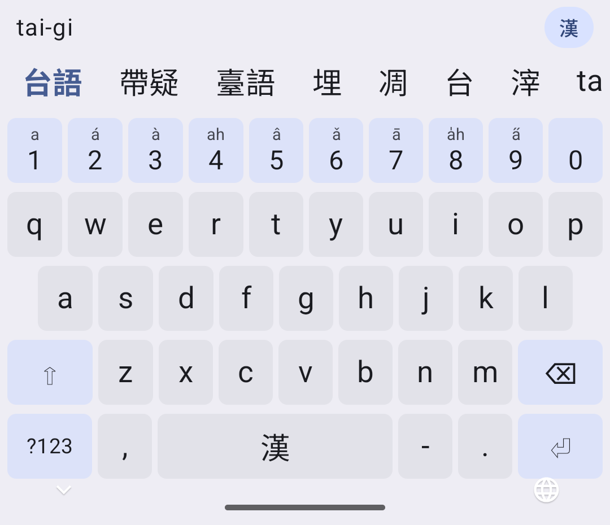
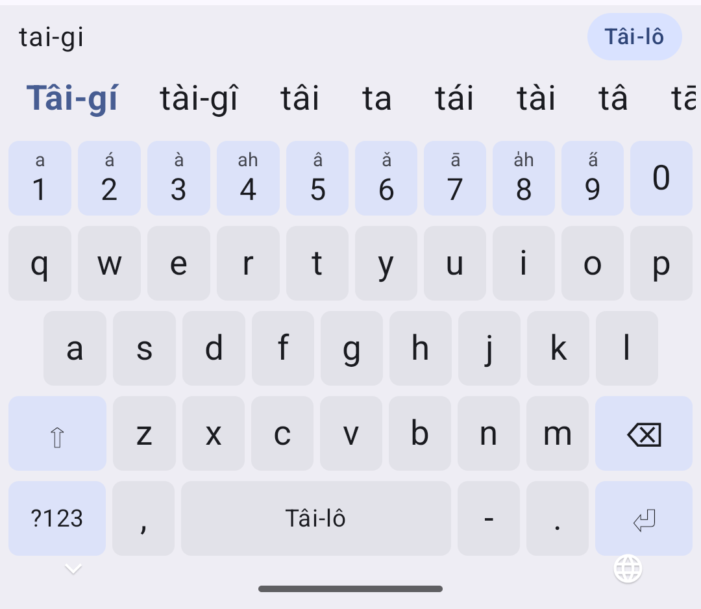

>**⚠️ Work in progress:** This project is under active development and is not yet useful for everyday typing. Features, behavior and the dictionary may change without notice, and no release is available.
>
>**⚠️ 開發中：** 本專案仍在積極開發階段，目前尚不適合日常輸入使用。功能、行為與辭典內容都可能隨時變動，也尚未提供任何正式釋出版本。

# Phah Taibun Droid 拍台文

<p>
  
  
</p>

*Typing `taigi`: Hàn-lô output (left) and Tâi-lô output (right), switched by tapping the input buffer or swiping the candidate bar.*

*輸入 `taigi`：左為漢羅輸出，右為台羅輸出；點選輸入區或上下滑動候選字列即可切換。*

## About 這是啥

An Android software keyboard (input method editor) for [Taigi](https://en.wikipedia.org/wiki/Taiwanese_Hokkien) (台語, Taiwanese Hokkien). Type in either [POJ (Pe̍h-ōe-jī, 白話字)](https://en.wikipedia.org/wiki/Pe%CC%8Dh-%C5%8De-j%C4%AB) or [Tâi-lô (台羅)](https://en.wikipedia.org/wiki/Taiwanese_Romanization_System) — or a mix of both — and get Hàn-lô (漢羅, Han characters mixed with romanization) or properly tone-marked romanization.

拍台文是 Android 平台上的[台語](https://zh.wikipedia.org/zh-tw/%E8%87%BA%E7%81%A3%E8%A9%B1)軟體鍵盤（輸入法編輯器）。您可以用[白話字（POJ）](https://zh.wikipedia.org/zh-tw/%E7%99%BD%E8%A9%B1%E5%AD%97)或[台羅（Tâi-lô）](https://zh.wikipedia.org/zh-tw/%E8%87%BA%E7%81%A3%E9%96%A9%E5%8D%97%E8%AA%9E%E7%BE%85%E9%A6%AC%E5%AD%97%E6%8B%BC%E9%9F%B3%E6%96%B9%E6%A1%88)輸入，兩者混用也可以，輸出漢羅（漢字與羅馬字混寫）或標好聲調符號的羅馬字。

## Features 特色

* **POJ and Tâi-lô, side by side** — `chhiu` and `tshiu`, `hoe` and `hue`, `seng` and `sing` are all understood. Your choice of system only affects the output.
* **No tone marks needed** — type `taigi` and get 台語 or **Tâi-gí**; tones come from the dictionary. Tone numbers (`tai5gi2`) narrow the candidates when you want them to.
* **Fuzzy input** — optionally accept `o` for `o͘`, omitted nasalization (`a` for `aⁿ`), omitted final `h`, omitted or mixed-up entering-tone codas `p`/`t`/`k`/`h` (`ta` or `tat` for `ta̍k`), mixed-up nasal codas `m`/`n` and `n`/`ng`, unaspirated spellings, pinyin-style `b`/`g` for `p`/`k`, and accent variants such as `kue`/`ke`, `gí`/`gú`, `chhiⁿ`/`chheⁿ`, `ji̍t`/`li̍t`. Mandarin-pinyin initials are always understood: `d` for `t`, `z`/`zh` for `ts`, `c`/`q` for `tsh`, `x` for `s` — so `dageho` can find 逐家好 (ta̍k-ke-hó).
* **Switch output anytime** — tap the input buffer, or swipe the candidate bar up or down, to flip between Hàn-lô and romanization. Words already chosen are re-rendered too.
* **No separators needed** — `lihokamsia` is segmented into `lí hó kám-siā` (你好感謝); pick a word to convert the input piece by piece.
* **Learns your choices** — frequently chosen words move up, except in incognito fields; password, e-mail and URL fields bypass conversion entirely.

* **白話字、台羅皆可**——`chhiu` 與 `tshiu`、`hoe` 與 `hue`、`seng` 與 `sing` 都能辨識，選用哪一套系統只影響輸出結果。
* **不必輸入聲調符號**——輸入 `taigi` 即可得到「台語」或 **Tâi-gí**，聲調由辭典補上；需要時也可以用數字調號（`tai5gi2`）縮小候選範圍。
* **模糊輸入**——可選擇接受以 `o` 代替 `o͘`、省略鼻化音（`a` 代替 `aⁿ`）、省略字尾 `h`、省略或混用入聲韻尾 `p`／`t`／`k`／`h`（以 `ta` 或 `tat` 代替 `ta̍k`）、韻尾 `m`／`n` 或 `n`／`ng` 不分、不分送氣、以拼音式的 `b`／`g` 代替 `p`／`k`，以及 `kue`／`ke`、`gí`／`gú`、`chhiⁿ`／`chheⁿ`、`ji̍t`／`li̍t` 等腔調差異。華語拼音的聲母一律可用：`d` 代替 `t`、`z`／`zh` 代替 `ts`、`c`／`q` 代替 `tsh`、`x` 代替 `s`，因此輸入 `dageho` 也能找到「逐家好」（ta̍k-ke-hó）。
* **隨時切換輸出**——點選輸入區，或上下滑動候選字列，即可在漢羅與羅馬字之間切換，已選定的詞也會一併重新呈現。
* **不必分隔音節**——`lihokamsia` 會自動切分為 `lí hó kám-siā`（你好感謝），可逐段選字轉換。
* **記憶選字習慣**——常選的詞會排到前面（無痕輸入欄位除外）；密碼、電子郵件與網址欄位則完全不經轉換。

## Usage 使用

After installing, open **Phah Taibun Droid** from the launcher and follow the two setup steps: enable the keyboard in system settings, then switch to it. The same screen lets you choose POJ or Tâi-lô, the default output, and which fuzzy-matching rules to use.

安裝後，請從桌面開啟「拍台文」，依照畫面上的兩個步驟操作：先在系統設定中啟用本鍵盤，再切換為目前使用的鍵盤。同一個畫面也可以選擇白話字或台羅、預設輸出方式，以及要使用的模糊比對規則。

| Key 按鍵 | Action 功能 |
|---|---|
| Letters 字母 | Type romanization 輸入羅馬字 |
| `1`–`9` after a syllable 接在音節後 | Tone number 聲調數字 |
| `-` | Syllable separator; `--` marks a neutral tone 音節分隔；`--` 表示輕聲 |
| Space 空白鍵 | Choose the first candidate 選擇第一個候選詞 |
| Enter 輸入鍵 | Commit the input as shown 依目前顯示內容送出 |
| Tap buffer / swipe ↕ candidates 點輸入區／上下滑候選列 | Toggle Hàn-lô ⇄ romanization 切換漢羅 ⇄ 羅馬字 |

## Build 組建

Requirements: Android SDK (compile SDK 37) and JDK 17 or newer; Gradle provisions its own JDK toolchain.

需求：Android SDK（compile SDK 37）與 JDK 17 以上版本；Gradle 會自行準備所需的 JDK 工具鏈。

```sh
./gradlew :app:assembleDebug     # build the debug APK 組建除錯版 APK
./gradlew :core:test             # run the input engine tests 執行輸入引擎測試
```

The dictionary is committed as `app/src/main/assets/lexicon.tsv`. To regenerate it from the upstream datasets:

辭典已以 `app/src/main/assets/lexicon.tsv` 納入版本控制。若要從上游資料集重新產生：

```sh
./scripts/fetch-lexicon-sources.sh
./gradlew :tools:dictbuilder:buildLexicon
```

The code is organized as a pure-Kotlin input engine (`core`), the Android keyboard and settings app (`app`), and the dictionary compiler (`tools/dictbuilder`).

程式碼分為三部分：純 Kotlin 的輸入引擎（`core`）、Android 鍵盤與設定程式（`app`），以及辭典編譯工具（`tools/dictbuilder`）。

## Acknowledgements 感謝有您

The dictionary is built from datasets published by the [ChhoeTaigi 找台語](https://github.com/ChhoeTaigi/ChhoeTaigiDatabase) project. Many thanks to everyone who created and shared them:

本輸入法的辭典資料來自 [ChhoeTaigi 找台語](https://github.com/ChhoeTaigi/ChhoeTaigiDatabase)計畫所公開的資料集，衷心感謝所有建立與分享這些資料的人：

* **台文華文線頂辭典** — base data by Prof. Tēⁿ Liông-úi (鄭良偉), with additions and editing by Prof. Iûⁿ Ún-giân (楊允言) and volunteer typists and proofreaders. [CC BY-SA 4.0](https://creativecommons.org/licenses/by-sa/4.0/)
* **iTaigi 華台對照典** — by the [iTaigi](https://itaigi.tw/) team and contributors. [CC0](https://creativecommons.org/publicdomain/zero/1.0/)

* **台文華文線頂辭典**——鄭良偉教授提供基礎資料，楊允言教授與打字、校對志工增補編修。[CC BY-SA 4.0](https://creativecommons.org/licenses/by-sa/4.0/deed.zh_TW)
* **iTaigi 華台對照典**——由 [iTaigi](https://itaigi.tw/) 團隊與貢獻者提供。[CC0](https://creativecommons.org/publicdomain/zero/1.0/deed.zh_TW)

See [NOTICE](./NOTICE) for full third-party copyright and license information.

完整的第三方版權與授權資訊，請參閱 [NOTICE](./NOTICE)。

## License 授權

Copyright (C) 2026.  YOU, Hui-Hong

This program is free software: you can redistribute it and/or modify it under the terms of the [GNU General Public License](./LICENSE) as published by the Free Software Foundation, either version 3 of the License, or (at your option) any later version.

本程式為自由軟體，您可以依據自由軟體基金會所發布的 [GNU 通用公共授權條款](./LICENSE)第 3 版，或（依您的選擇）任何後續版本，重新散布及／或修改本程式。
